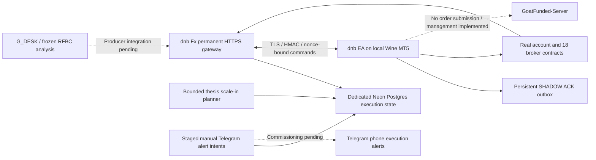

# dnb Fx production readiness — 14 October 2026

Latest continuation: [verified backend changes and remaining commissioning blockers](DNB_FX_CONTINUATION_2026-10-14.md). Historical statements below are checkpoint evidence, not a current running-state attestation.

**NOT READY FOR LIVE AUTO.** GOAT automatic execution remains blocked. Native broker submission/recovery primitives now exist, and an isolated MetaQuotes demo test placed and closed one synthetic minimum-volume order. This was a transport/recovery test, not a strategy trade. The full unattended strategy executor and native scale-in lifecycle remain unfinished; attaching the EA to GOAT does not authorise trading. Production `strategy2-round2-wip` was not changed.

## Continuation checkpoint — native recovery and signal diagnostics

The user now authorises ongoing demo validation using genuine G_DESK/RFBC signals with the same conservative risk policies. Further synthetic entry tests are excluded from routine operation. GOAT remains manual-only pending written architecture approval and verified account-specific daily/trailing/payout anchors.

- [Native demo evidence](evidence/native-demo-broker.jsonl): EURUSD 0.01 synthetic placement lost its acceptance response; exact magic/comment/order/deal identity recovered order `58897095310`, deal `58502419659`. A real normal MT5 restart recovered the same entry without resubmission. Cleanup order `58897443784`, deal `58502763194`, closed that test position. This test did not originate from the backend queue and does not prove the complete backend-restart scenario.
- [Native deterministic broker tests](evidence/native-broker-selftest.json): 31 native mocked tests passed with no broker orders. [Compilation](evidence/DnbBrokerSelftest-compile.log) verifies current recovery primitives. Broker protection exits with inherited magic are linked through position identity; unrelated identities remain quarantined.
- [Permanent Telegram delivery](evidence/telegram-permanent-test.json): authenticated system-test endpoint returned HTTP 200 and Telegram delivery status 200. This confirms the user-installed bot credentials, not actual strategy notification delivery or manual-fill reconciliation.
- [G_DESK diagnosis](evidence/gdesk-no-trade-diagnostic.json): a later mailbox decision reported SYSTEM_FAILURE because 14/18 contracts lagged the expected completed H1 bar. An earlier genuine NO_TRADE rejected GBPCAD on spread and missing pullback confirmation. Neither is permission to relax the strategy or fabricate an entry. The adapter now invalidates caches at the H1 boundary, labels incomplete bars explicitly, and recognises Sunday FX reopening. The existing production context service has not received these feature-branch fixes.
- `dnb_sources` and `dnb_source_worker` consume the actual GitHub analysis mailbox and adapt only genuine entry events from the unchanged frozen RFBC evaluator. Immutable source receipts, restart repair, alert quarantine and authenticated source health are implemented. The first RFBC proposal per pair/H4 bar remains fixed across subsequent quotes. Source consumption flags default off until commissioning; no price-inferred lifecycle event becomes a broker fill.
- Demo snapshots/history use separate Postgres tables and exact login `5057377621` / `MetaQuotes-Demo`. They cannot replace account `315307814` risk evidence. `DnbDemoObserver` shares one-chart contract/snapshot/history code, maps canonical `.x` names to the demo broker's actual contracts, and has no order permission. It is an observation component, not the completed full-time strategy executor.

The remaining sections describe the accepted earlier SHADOW foundations. Their historical “not implemented” statements about native primitives/Telegram credentials are superseded only by the narrow evidence above. End-to-end strategy execution, native management/scale-ins, actual auto-trade Telegram messages, funded manual-fill identity resolution, full restart/outage tests, and self-service verified GOAT activation remain work to finish. Missing GOAT approval/anchors are not the only current blockers.

### Execution protocol implementation checkpoint

The next implementation adds `DnbStrategyDemo`, an account-bound genuine-signal parser and native submission path. It uses committed Postgres submission intent, immutable local request/intent records, broker identity search, and a recovery-only branch whenever the server reports an existing intent. A new local journal key preserves ownership proofs through transport credential rotation. Native lifetime thesis reservations and broker-derived profitable-leg admission support at most two add-ons. Netting additions must preserve the merged SL/TP and reject unmapped/manual entries. Own pending cancellation, emergency downside closure and the frozen RFBC Friday exit are implemented behind the demo binding.

The server now has separate strategy commands, prospective demo validation epochs, lifecycle events and atomic notification intents. [179 backend tests](evidence/dnb-execution-python-tests.log) pass, including restart/lost-response intent reuse, scale-in admission, conflicting requests, late ACKs, snapshot receive ordering and notification ambiguity. [Demo strategy compilation](evidence/DnbStrategyDemo-compile.log) records zero errors/warnings for the recorded source hash. Compilation and fixture tests do not establish unattended operational readiness.

**This executor remains unarmed and is not the currently attached EA.** The running chart is `DnbDemoObserver`; [permanent observation](evidence/dnb-source-demo-observation.json) proves all 18 contracts, fresh snapshots and complete isolated history from one chart. [Actual broker-history reconciliation](evidence/demo-broker-history-reconciliation.json) identifies the earlier synthetic entry and its real close, with $0.79 net. No further synthetic position was placed.

Still required before commissioning this executor: renewed native protocol/recovery simulations against the exact final binary; authenticated strategy-driven SL/TP/modification management; prospective daily-reset continuity; complete manual Telegram fill identity resolution; integrated native scale-in/management recovery; final deployment/installation and extended outage validation. The prospective demo epoch currently expires after 24 hours and fails closed rather than inventing a reset anchor. GOAT authority remains separately absent and its AUTO path stays disabled.

The user clarified that the 15:04/16:05 UTC G_DESK scans were analyzed but publication was blocked by safety checks, with no specific GitHub HTTP error. Publication troubleshooting is explicitly separate from this build. No old decision was republished; stale mailbox decisions are rejected. The permanent consumer has also observed normal RFBC `stale` entry-window results outside the completed-H4 admission window. Telegram transport works, but no genuine strategy-trade notification is claimed by the system-test evidence.

## Implemented architecture



GitHub remains an analysis mailbox only. No GitHub execution queue exists. Legacy tracked balances, Exness fills, $5K profile overlays and price-inferred broker outcomes are excluded from the bridge. Production's old Telegram/analysis service remains deployed on `b2c372eeeeb2774705b2bc1b82058fec11908a27`; its account assumptions must not be treated as validated dnb account risk.

## Permanent topology and monitoring

- Service **dnb-fx**, `srv-db7nv1t9fdbs73eto5d0`, Douglas Personal confirmed Render workspace, Frankfurt.
- [Permanent service](https://dnb-fx.onrender.com), [dashboard](https://dashboard.render.com/web/srv-db7nv1t9fdbs73eto5d0).
- **UptimeRobot target: https://dnb-fx.onrender.com/health**. Healthy HTTP **200**, JSON `{"auto_available":false,"mode":"SHADOW","ok":true,"product":"dnb Fx","storage":"postgres"}`. Database failure returns 503 with a sanitized error. Monitor this endpoint; the disposable service is not the monitor target.
- Health proves application/database availability, not MT5 freshness or trading readiness. Signed `/fx101/mt5/status` provides account freshness and gates. It needs dynamically signed timestamp/nonce headers and must not be exposed as an unauthenticated monitor endpoint.
- Dedicated Neon project **dnb-fx-execution**, `flat-mud-22554760`, Frankfurt, Postgres 17, database `dnb_fx`, operational branch `execution-shadow` (`br-shiny-tree-babhfr6r`). Isolated fixture test branch `validation-2026-10-14` (`br-floral-mode-baqh9wvx`). No pre-existing project or production database was changed.
- Render runtime plan remains **free**. The URL is permanent, but free-service suspension/cold starts are unsuitable for unattended live execution. Always-on hosting, capacity, backup/restore, retention/quota monitoring and production credentials/least privilege need a later validated rollout. Current Neon restore history is six hours; this is not a complete backup plan.
- Auto-deploy OFF; branch `feature/mt5-goat-auto`; build `pip install -r monitor/requirements.txt`; start `python monitor/dnb_fx_app.py`; `PYTHONPATH=monitor`.
- Exact non-secret settings and secret key names: [DNB_RENDER.env.example](DNB_RENDER.env.example). `DNB_DATABASE_CA_FILE`, manual-alert, legacy-overlay and RFBC flags show effective defaults, not additional enabled workers. No Telegram or legacy production database secret was copied.

## Durable state and security

Postgres stores snapshots, reconciliation differences, commands/ACKs and replay nonces. Account advisory transaction locks serialize read-check-write operations across replicas. Unique trade IDs, command IDs and thesis/confirmation IDs prevent duplicate reservations. Concurrent losing producers compare immutable command fields rather than silently accepting a conflicting winner. ACK writers re-read the committed winner and reject conflicts.

Connections are scoped to one Flask request, rolled back/closed at teardown. TLS checks the server hostname and Linux CA bundle. Ambiguous commits are not automatically retried. SQLite fallback is forbidden by the permanent gateway's durable-storage setting. Raw snapshots retain 24 hours and ticket-difference records 30 days; commands/ACKs/thesis/alert records are retained. Quota alerts and long-term archive/retention for those records are still required.

Requests retain TLS, HMAC body/method/path/time binding, 15-second timestamps, unique durable nonces, account/server binding, strict JSON including duplicate/unknown/nonfinite rejection, 128 KiB body limit, authenticated rate limit and sanitized errors. Command response signatures bind to request nonce. The permanent bridge uses a newly generated private credential distinct from the disposable service; the old credential returned 401 on the permanent endpoint. No credential value is in this report or Git. No MT5 trading password was requested, inspected or transmitted.

## Rules and payout objective

Current official verification is in [GOAT_RULES_VERIFIED_2026-10-14.md](GOAT_RULES_VERIFIED_2026-10-14.md). Important correction: current [Stride](https://help.goatfundedtrader.com/en/articles/17333437-goat-stride-model) and [HERO](https://help.goatfundedtrader.com/en/articles/16097387-instant-hero-model) agree on a **fixed $125** trailing loss amount, rising with the intraday high of balance/equity, capped at $2,500 and reset after payout. The older uncapped proportional rule in the historical SHADOW report is superseded. Historical highs and payout-reset evidence remain missing.

Current [payout rules](https://help.goatfundedtrader.com/en/articles/10742264-how-payouts-work-eligibility-request-processing-and-arrival) state a 6% initial cap for the first two requests, a 3% processing fee after split, and dashboard UTC eligibility. With $150 eligible gross and standard 90% split, estimated receipt is $130.95, subject to review/deductions. Six $12.50 net profitable days and best day <=15% of period profit remain required. User reports purchase **7 October** and first trade **8 October**: 60-second holding time applies; the new best-win/worst-loss condition for purchases on/after 8 October does not apply based on that reported date. The exact dashboard payout timestamp remains unverified; 22 October is an estimate.

At $2,476.17, deficit is $23.83; reaching $2,650 requires $173.83 additional net profit. This is a planning target, never a risk escalation trigger. `dnb_policy` calculates cap/fee/deficit, qualifying days/consistency/timing blockers and a new-risk pause at target or pending payout. It never authorizes execution. Broker-history ingestion and enforcement in a complete live signal path remain unfinished.

Written GOAT architecture approval has not been supplied. The current hosting and signals policies remain a live blocker. Exact support question: **For account 315307814, may I use my own self-developed, AI-assisted-engineered EA and personally owned RFBC/G_DESK strategies, with analysis generated on my Render backend and delivered by authenticated HTTPS to MT5 running on my own local PC, whose direct broker connection uses no VPN/VPS/proxy or copier? Does autonomous execution or manual execution from my own Telegram alerts comply with the hosting, independent-decision, signals and EA-authorship rules?** Also request the verified historical/daily floors, fixed EST versus civil New York reset time, payout-reset baseline and any account-specific limits. No support message was sent by the agent.

## Risk and structure

The strategy entry/SL/TP are preserved. Risk budget determines volume, rounded down; below-minimum volume rejects. No tightening of a structure stop is introduced to fit money risk. Scale-ins require at least 1.5 R:R in the planner. The frozen strategies themselves were not rewritten; technical structure validity and fresh confirmation still need trustworthy signal-path integration.

- Per trade: 0.25% of smaller balance/equity, about $6.19 at current observation.
- Aggregate open/pending/manual stop risk: 0.60%, about $14.86.
- Same currency direction: 0.40%, about $9.90, with no offsetting of opposite currency legs. This buffers concentrated exposure shared by different pairs. XAU is counted separately and its USD direction is included.
- Metal: 0.25%, about $6.19; existing duplicate-symbol protection limits ordinary gold entries.
- Floating-loss guard: 0.70% of balance, about $17.33, below the firm's 1% (~$24.76).
- Daily planning guard: 2.50% of verified reset anchor, below firm 3%. Daily anchors are not invented from a current observation for real authorization.
- Trailing planning floor: `min(2500, verified_peak - 125) + 12.50`, reserving $12.50 above the official floor, including at cap. This replaces the earlier proportional 4.50% formula. Historical proof and payout-reset handling remain blocked.
- Five ticks conservative entry allowance and maximum 30 tick spread; margin uses a maximum 80% of free margin. Native `OrderCalcProfit`/`OrderCalcMargin` calculations remain independent.

New risk rejects stale manual-exposure quotes, missing SL, nonpositive stop-limit entry, already-breached stops, duplicate/opposite symbols, bad contracts/geometry, insufficient margin and unknown anchors. These are admission checks, not emergency broker closure protection; broker management is absent. Fees, gaps, changing conversion rates, session/fill-mode restrictions, manual-intervention races and cross-account hedges still prevent live readiness.

## Safe pyramiding and offline fallback status

`dnb_thesis` stages intentional scale-ins distinct from ordinary duplicate commands. It requires a common thesis ID, unique command and fresh confirmation IDs, broker-confirmed ticket membership, net-profitable existing legs including commission/swap, favorable price relative to each entry, valid fresh structure, equal/smaller risk than initial, unchanged prior stops and independent geometry/R:R plus account/portfolio/directional guards. Unmapped manual positions and same-symbol pending orders reject. Maximum **two add-ons**; durable reservations survive restart, count toward lifetime limits and block another add-on while submission remains uncertain.

**This is backend planning/reservation support only.** The EA still rejects ordinary duplicate-symbol commands and has no native scale-in submission protocol or broker-history binding. No fake thesis membership is assigned from matching prices/comments. Native scale-in lost-ACK/partial-fill/reconciliation tests have not passed and must precede AUTO.

`dnb_alerts` stages durable manual alert intents separately from execution state and formats each add-on with its decision ID, thesis ID, add-on number and total thesis risk. It claims delivery before Telegram I/O; ambiguous delivery stays quarantined rather than blindly redelivering. Any possibly delivered manual alert blocks automated re-entry on that symbol until broker history is reconciled. Reconnection records candidate tickets without guessing their identity; an empty snapshot does not clear uncertainty because a manual trade may already have closed. Kill or offline conditions do not erase analysis intent.

**The fallback is not commissioned on the permanent service:** no Telegram credentials/worker are installed, no live producer path is connected, and `DNB_MANUAL_ALERTS_ENABLED` defaults to 0. Fixture tests use a fake sender. Without fresh broker state alerts explicitly carry no authorized lot size. Full eligible phone alerts, actual Telegram delivery, source integration, and confirmed manual fill/closure reconciliation remain work to complete; do not treat this staged library as an operating fallback.

## Native 18-symbol validation

[Native evidence](evidence/dnb-native-contracts.json): 144 synthetic constructions, all 18 symbols × eight order types; all native profit and margin calculations passed, all types advertised as supported, no broker orders sent. Broker specs below are observed values and can change. XAUUSD was independently included.

| Symbol | Min / step lots | Tick size | Loss tick value USD | Buy margin / lot USD | Eight constructions |
|---|---:|---:|---:|---:|---|
| EURAUD.x | 0.01 / 0.01 | 1e-05 | 0.6965 | 2225.0 | calculations pass |
| EURUSD.x | 0.01 / 0.01 | 1e-05 | 1.0 | 2225.0 | calculations pass |
| XAUUSD.x | 0.01 / 0.01 | 0.01 | 1.0 | 40887.0 | calculations pass |
| AUDJPY.x | 0.01 / 0.01 | 0.001 | 0.6293899952 | 1393.0 | calculations pass |
| CADJPY.x | 0.01 / 0.01 | 0.001 | 0.6293899952 | 1401.0 | calculations pass |
| GBPUSD.x | 0.01 / 0.01 | 1e-05 | 1.0 | 2639.0 | calculations pass |
| GBPAUD.x | 0.01 / 0.01 | 1e-05 | 0.6965 | 2639.0 | calculations pass |
| CHFJPY.x | 0.01 / 0.01 | 0.001 | 0.6293899952 | 2386.0 | calculations pass |
| NZDUSD.x | 0.01 / 0.01 | 1e-05 | 1.0 | 1117.0 | calculations pass |
| EURCAD.x | 0.01 / 0.01 | 1e-05 | 0.7005695631 | 2225.0 | calculations pass |
| EURGBP.x | 0.01 / 0.01 | 1e-05 | 1.31944 | 2225.0 | calculations pass |
| GBPCAD.x | 0.01 / 0.01 | 1e-05 | 0.7005695631 | 2639.0 | calculations pass |
| USDJPY.x | 0.01 / 0.01 | 0.001 | 0.6293899952 | 2000.0 | calculations pass |
| USDCAD.x | 0.01 / 0.01 | 1e-05 | 0.7005695631 | 2000.0 | calculations pass |
| EURJPY.x | 0.01 / 0.01 | 0.001 | 0.6293899952 | 2225.0 | calculations pass |
| USDCHF.x | 0.01 / 0.01 | 1e-05 | 1.1931750388 | 2000.0 | calculations pass |
| AUDUSD.x | 0.01 / 0.01 | 1e-05 | 1.0 | 1393.0 | calculations pass |
| GBPJPY.x | 0.01 / 0.01 | 0.001 | 0.6293899952 | 2639.0 | calculations pass |

These calculations construct `MqlTradeRequest` objects but do not submit them or establish broker acceptance. Fill policy, trading session admission, stop/freeze races, pending activation, partial fills and native management remain unproven. Margin figures are observations, not hardcoded production values.

## Tests and actual E2E

| Evidence | Result / limitation |
|---|---|
| [Backend regression](evidence/dnb-python-tests.log) | 113 tests pass, including rules, scale-in admission, alert ambiguity, restart reservations and original security/risk/Fx101/G_DESK checks. Fixture tests are not broker execution proof. |
| [RFBC regression](evidence/dnb-rfbc-tests.log) | Four frozen RFBC tests pass. |
| [Operational paths](evidence/dnb-operational-selftest.log) | Eight deterministic decision paths plus alert actions pass. Frozen RFBC self-test risk labels remain historical strategy configuration, not dnb execution authorization. |
| [Real Postgres concurrency](evidence/dnb-postgres-write.json) | Eight simultaneous requests/producers: one nonce winner; immutable conflicting commands and ACKs rejected; transaction rollback isolated; remote thesis reservations and ambiguous manual-alert quarantine survived reconnection. Initial 5s lock contention was corrected with bounded transaction-local waits. This is not full load/capacity testing. |
| [Independent process recovery](evidence/dnb-postgres-recover.json) | Committed command, ACK and replay nonce recovered from remote test branch in a new process. |
| [Native compilation](evidence/mql5-compile.log) | Actual MetaEditor: 0 errors, 0 warnings; source/EX5 SHA256 recorded. |
| [Permanent SHADOW E2E](evidence/dnb-shadow-e2e.json) | Command `646302155cfe47ce860feca86d15bd5d`; matching native/server SHADOW ACK, unchanged empty positions/orders and all 18 specs. |
| [MT5 restart/outbox](evidence/dnb-mt5-restart.json) | Normal profile restart, fresh one-second snapshot and recreated ACK confirmation marker. Simulation removed only `.sent`, preserving `.ack`; no real broker acceptance was involved. |
| [Permanent deployment survival / final state](evidence/dnb-final-state.json) | Command/ACK survived Render deployments, credential rotation authenticated, disposable key rejected, fresh observation restored after deploy, both kills engaged. |
| [Expanded failure matrix](DNB_FAILURE_MATRIX.csv) | Explicitly distinguishes actual, simulated and missing critical paths. |

**Critical unproven scenario:** broker accepts an order, network dies before ACK, terminal/backend restarts. Native pre-submission intent, broker identity search, complete order/deal history and management are still absent. The SHADOW outbox test does not prove this scenario. No real manual position, pending order, partial fill, rejection, cancellation, modification, stop-out or protective close was created for testing. PC reboot and extended physical network outage remain untested.

## Local installation and exact restart procedure

Wine prefix `/home/db/.mt5`; MT5 data `/home/db/.mt5/drive_c/Program Files/MetaTrader 5`. Existing proven namespace retained to avoid losing journals:

- `MQL5/Experts/Fx101/Fx101GoatBridge.mq5` / `.ex5`, user-facing description **dnb EA**.
- Preset `MQL5/Presets/dnbEA.set`, URL `https://dnb-fx.onrender.com`, mode 2/SHADOW, input local kill false, timer 5s. Persistent `MQL5/Files/Fx101Bridge/KILL` is engaged and overrides that input.
- One saved EURUSD.x observer chart; normal profile URL updated. WebRequest permanent URL was added by the user and passed authenticated observation/restart.
- Algo Trading/AllowLiveTrading OFF; DLL imports OFF. Private `Fx101Bridge/token.txt` remains 0600 in a private directory. Permanent key is unrelated to the MT5 password.
- Journals `.ack`/`.sent`, boot state and observed peak preserved. Unknown ACKs now back off one hour; transient failures one minute, preventing the known orphan from continuously occupying the bounded scan. No orphan is falsely marked acknowledged.
- User installed `216.24.57.18 dnb-fx.onrender.com # dnb Fx validation` in `/etc/hosts`. TLS remains verified. This scoped mapping and the old disposable mapping are temporary and must be removed once normal DNS works; addresses may change.

1. Engage server kill, verify signed status, create local KILL and preserve all journals/database. Do not reset historical anchors.
2. Close MT5 normally: `WINEPREFIX=/home/db/.mt5 WINEDEBUG=-all wine taskkill /IM terminal64.exe` (no force). Wait for normal shutdown.
3. Restart: `WINEPREFIX=/home/db/.mt5 WINEDEBUG=-all wine '/home/db/.mt5/drive_c/Program Files/MetaTrader 5/terminal64.exe' /portable`. After PC boot use this same normal launch. Do not use the old custom `/config:` startup method or pass a password.
4. Confirm saved account 315307814 / GoatFunded-Server / USD, one attached observer, permanent input URL and WebRequest permission, SHADOW, Algo OFF, DLL OFF, local KILL.
5. Run `.venv/bin/python tools/mt5_probe.py status` from repo; check capture age <15s, exact account/balance/equity, every position/order, all 18 specs and unresolved journals/manual-alert intents. Check permanent `/health`.
6. Remain killed if any state is unknown. Normal MT5 restart passed; an actual PC reboot was not performed.

Recompile/install: `.venv/bin/python tools/compile_mt5.py --install` with authorized Wine-prefix access. Its unique log prevents stale compiler success. Never publish `bridge-private/`.

## Kill switches and rollback

Server: `FX101_MT5_KILL_SWITCH=1`, redeploy setting and verify signed status. Local: create `MQL5/Files/Fx101Bridge/KILL` or input local kill true. KILL blocks planning/outbox and persists; observation continues. OFF stops EA activity. Neither switch currently closes broker positions or cancels manual pending orders because management is not implemented.

Rollback: engage kills first; remove/close the observer while preserving journals/keys/peaks; restore the saved profile URL if reverting to historical observation; suspend the dedicated gateway if needed. Keep the remote database and test evidence. Remove only the exact commented hosts mappings when DNS permits. Do not delete the Neon project/branches, reset the account history or reinstall the unsafe original draft. Feature changes can be reverted through reviewed Git history; no force update or production rollback is needed.

## Remaining live gates

Written GOAT permission and account-specific rule evidence; verified daily/historical/payout-reset anchors; complete native order submission and management; durable local intent before broker I/O; account-bound broker identity/history search after ambiguous acceptance; lifecycle/partial-fill/manual reconciliation; native scale-in protocol and recovery; actual Telegram fallback commissioning and manual-fill identity resolution; trusted news/calendar/holding/payout enforcement; live structure provenance; commission/conversion/gap/session checks; concurrency/manual races; always-on infrastructure, least-privilege DB role, backup/restore and capacity testing; physical outage/reboot and full native failure matrix; security review; integrated G_DESK/RFBC/Telegram end-to-end regression.

Only after these pass may a reviewed production merge/deploy be considered. There is no AUTO enablement recipe in this report and no planned live order authorized by it.

## Commits and changed files

Base `db49a0dd0d0ae7f64a01a2c48b920983ee1ba689`. Feature commits through implementation:

```text
59401f5 — fix(mt5): quarantine live execution pending safety validation
9084f00 — feat(mt5): add authenticated durable shadow bridge and 18-market broker adapter
5445a10 — fix(mt5): preserve Render TLS proxy metadata and expose sanitized transport diagnostics
1c0e31e — fix(mt5): reject idempotency conflicts and preserve shadow audit evidence
f167246 — fix(mt5): persist and drain shadow acknowledgements beyond command expiry
ecf5993 — docs(mt5): record official rules, real shadow evidence and AUTO blockers
00423cd — docs(mt5): verify final kill switches and live observation state
e604a1f — docs(mt5): disclose remaining storage and outbox limitations
a5d51ac — Add isolated durable dnb gateway and corrected GOAT risk policy
b304660 — Stage bounded thesis scale-ins and durable offline alert quarantine

```

The final evidence/handoff commit is recorded in `git log`; permanent service validated on `b3046604778c406293f4e990bf659bec76b44ec5`. The subsequent handoff edits remove an unused old trailing constant, correct its test name, change probe default URL and update the isolated storage validation tool and documentation/evidence; no native binary or deployed behavior is altered.

Changed files since base (plus this report, DNB_RENDER.env.example, DNB_FAILURE_MATRIX.csv and final dnb evidence):

```text
.gitignore
docs/FX101_MT5_GOAT_BRIDGE.md
docs/GOAT_RULES_VERIFIED_2026-10-14.md
docs/MT5_FAILURE_MATRIX.csv
docs/MT5_RENDER_SHADOW.env.example
docs/evidence/dnb-native-contracts.json
docs/evidence/dnb-operational-selftest.log
docs/evidence/dnb-postgres-recover.json
docs/evidence/dnb-postgres-write.json
docs/evidence/dnb-python-tests.log
docs/evidence/dnb-rfbc-tests.log
docs/evidence/final-status.json
docs/evidence/local-mt5-observation.json
docs/evidence/mql5-compile.log
docs/evidence/operational-selftest.log
docs/evidence/python-tests.log
docs/evidence/rfbc-tests.log
docs/evidence/shadow-e2e-final.json
docs/evidence/shadow-e2e.json
docs/evidence/shadow-restart.json
monitor/dnb_alerts.py
monitor/dnb_fx_app.py
monitor/dnb_policy.py
monitor/dnb_thesis.py
monitor/mt5_bridge.py
monitor/mt5_risk.py
monitor/mt5_runtime.py
monitor/mt5_shadow_app.py
monitor/mt5_store.py
monitor/mt5_symbols.py
monitor/requirements.txt
monitor/sitecustomize.py
monitor/test_dnb_alerts.py
monitor/test_dnb_policy.py
monitor/test_dnb_thesis.py
monitor/test_mt5_bridge.py
monitor/webapp.py
mt5/Fx101GoatBridge.mq5
tools/compile_mt5.py
tools/mt5_probe.py
tools/validate_dnb_postgres.py

```

Final verdict: **NOT READY FOR LIVE AUTO**.
