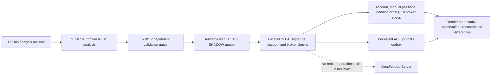

# Fx101 GOAT Stride execution audit and SHADOW evidence

**Verdict: NOT READY for AUTO validation.** No live trade was placed. AUTO is unavailable in both server behavior and EA source. Work is on `feature/mt5-goat-auto`; production `strategy2-round2-wip` and the existing Render production service were not modified. This is an observation/SHADOW implementation, not a finished autonomous executor.

## Architecture delivered

GitHub is not the execution queue. Snapshot capture occurs every five seconds. Capture freshness is checked separately from receipt time. Missing historical rule anchors, missing broker metadata, unknown risk and unsupported cancellation conditions reject real decisions. Account login/server/USD currency are bound on both sides. Request HMAC-SHA256 covers method, path, UTC timestamp, unique nonce and exact body; responses bind command fields to the request nonce. TLS is mandatory. Credentials are 32 random bytes represented as 64 lowercase hex characters, stored privately on the PC and as a Render secret. No MT5 trading password is used by the bridge.

Server schema rejects unknown fields, duplicate JSON keys, non-finite values, incorrect tickets/account binding, oversized bodies and replayed requests. Nonces and command IDs are stored in SQLite-compatible tables. Strong durability is NOT supplied by an ephemeral Render filesystem. HTTP header size is bounded by Waitress; bridge body limit is 128 KiB. Authenticated request limit is 90/minute. Waitress trusts forwarding protocol metadata only when the explicit Render proxy flag is enabled.

EA modes are OFF, OBSERVE, SHADOW, AUTO. Default is SHADOW with local kill enabled. AUTO initialization is rejected; server AUTO configuration becomes OFF. No `OrderSend`, CTrade order placement, modification, cancellation or closure exists. SHADOW ACKs are flushed before transmission. A persistent outbox retries ACKs independently of command expiry. `.sent` markers record successful server acknowledgement. Corrupt journals never cause a broker operation.

## Existing 18-market scope restored

EURUSD.x, GBPUSD.x, GBPJPY.x, USDCAD.x, EURJPY.x, AUDUSD.x, NZDUSD.x, USDCHF.x, EURGBP.x, CADJPY.x, CHFJPY.x, EURAUD.x, GBPAUD.x, EURCAD.x, GBPCAD.x, XAUUSD.x, USDJPY.x, AUDJPY.x.

This comes from the repository's prior 16-market desk plus the two symbols promoted by its G_DESK-only overlay. All 18 were observed with broker specifications. RFBC itself remains frozen to USDJPY/AUDJPY; only the external symbol adapter changes `c` names to `.x`. Current RFBC execution remains paused unless explicitly enabled; this work does not broaden its strategy or modify ChatGPT automations.

## Audit findings corrected or quarantined

The draft EA executed based on local AUTO before checking the server's SHADOW mode. Its replay protection was one in-memory last-command variable, its drawdown anchors reset at startup, its trailing floor used a capped fixed-dollar rule, and it lacked signature/expiry enforcement. Missing tick values could produce zero existing risk. Spread, margin, direction, order validity and stop/freeze checks were incomplete. Requested 0.01 volume was trusted too far. Stop-limit draft methods did not establish real compilation validity. Management/reconciliation paths were absent.

The draft backend accepted NaN/Infinity and partial snapshots, silently ignored malformed exposure risk, trusted supplied risk estimates/anchors, treated newly received stale snapshots as fresh, served account status without authentication, returned queued commands without response authentication, and accepted unverified EXECUTED ACKs. It recreated guessed $2,500 anchors on account refresh.

Runtime startup overlays also backfilled historical Exness positions and hardcoded a $5K account, stale balances, 1.25%/2.50% risk and price-inferred fills. The bridge runtime bypasses those overlays and Dukascopy-derived broker outcomes. Legacy overlays now require `FX101_LEGACY_OVERLAYS=1`; do not set it for this account. Existing production remains on its old commit and must not be mistaken for this SHADOW service.

Risk planning derives volume from broker tick size/value and the smaller balance/equity, rounds down without a positive epsilon, rejects below-minimum lots, uses conservative entry allowance and includes manual/pending exposure. Native planning also uses `OrderCalcProfit` and `OrderCalcMargin`. Internal guards: 0.25% per trade, 0.60% aggregate, 0.70% floating loss, 2.50% daily loss and 4.50% equity-peak loss. These are engineering guardrails, not official rule replacements. Fees, gaps and changing conversions can invalidate simple tick-risk estimates; live risk authorization remains blocked.

## Rules and evidence

Official rules, contradictions and required clarification are documented in [GOAT_RULES_VERIFIED_2026-10-14.md](GOAT_RULES_VERIFIED_2026-10-14.md). The proposed hosted-decision architecture cannot be presumed compliant with GOAT's October hosting, self-developed EA and signal restrictions. Written account-specific clarification is required before live implementation is considered.

Evidence files:

| Evidence | Result |
|---|---|
| [Python/backend tests](evidence/python-tests.log) | 83 tests pass: risk, security, schema, replay, durable IDs, duplicate/conflicting/late ACKs, synthetic endpoint restrictions, Fx101 and G_DESK regressions. |
| [RFBC tests](evidence/rfbc-tests.log) | Four RFBC regression tests pass. |
| [Operational self-test](evidence/operational-selftest.log) | Pass; eight deterministic strategy decision paths plus alert actions. |
| [Compiler](evidence/mql5-compile.log) | Installed MetaEditor: 0 errors, 0 warnings; exact source and EX5 SHA256 recorded. Compilation is not broker execution validation. |
| [Local account observation](evidence/local-mt5-observation.json) | MT5 315307814 / GoatFunded-Server; $2,476.17 balance and equity; 0 positions/orders; 18 broker symbols. |
| [Final actual SHADOW E2E](evidence/shadow-e2e-final.json) | Exact final compiled source, command `dc211b63db754f8a9380c3be7ec225e5`: matching native journal/Render ACK, SHADOW_OK, 0.03 lots / $6.15 estimated risk; exposure stayed zero. Earlier [probe](evidence/shadow-e2e.json) also passed at 0.02 lots / $4.14. |
| [Restart evidence](evidence/shadow-restart.json) | Normal-profile restart passed: fresh three-second-old snapshot, unchanged account and persistent ACK confirmation. Earlier custom-config restarts failed WebRequest permission and were corrected. |
| [Failure matrix](MT5_FAILURE_MATRIX.csv) | Each required edge case distinguishes actual proof, deterministic simulation and absent/untested live paths. |

The initial synthetic probe during rollout created a local SHADOW journal but disappeared from the free Render service's database during replacement. The stable-deployment probe above succeeded. This is direct evidence that ephemeral Render SQLite must never back AUTO. Python SQLite reconnect tests are not proof of Render persistence.

Real account synchronization was demonstrated with empty positions/orders. Manual-position and pending-order risk tests use fixtures; no live manual trade or pending order was created for testing. Real partial fills, broker rejections, trade acceptance followed by lost ACK, broker-history idempotency recovery, management, network outage and live-mode permutations are NOT tested. AUTO was never enabled, including for mode tests.

## Isolated Render installation

Service: `fx101-mt5-shadow`, `srv-db7mlbjncjis73erud60`.
Dashboard: https://dashboard.render.com/web/srv-db7mlbjncjis73erud60
URL: https://fx101-mt5-shadow.onrender.com
Source: DouglasBagambe/rfbc-backtest, branch `feature/mt5-goat-auto`.
Plan: free; auto-deploy off; build `pip install -r monitor/requirements.txt`; start `python monitor/mt5_shadow_app.py`; health `/health`.

Exact non-secret settings are in [MT5_RENDER_SHADOW.env.example](MT5_RENDER_SHADOW.env.example). During E2E `FX101_MT5_KILL_SWITCH=0`; after validation it was set to 1. The persistent local KILL file was also engaged. Observation continues in SHADOW; command planning is stopped. Secret `FX101_MT5_BRIDGE_TOKEN` is installed and must not be printed or committed. No production Turso or Telegram secrets were copied into the isolated service. This service has no market worker, Telegram sender or real broker command path.

For future production validation, choose a persistent remote database with proven transactions, concurrency, nonce uniqueness and command recovery. Do not merely set a durability flag on this free instance. No AUTO env var recipe is supplied because it would not make this implementation ready.

## Actual local installation

Wine prefix `/home/db/.mt5`; installed MT5 data directory `/home/db/.mt5/drive_c/Program Files/MetaTrader 5`.

- EA source/EX5: `MQL5/Experts/Fx101/Fx101GoatBridge.mq5` and `.ex5`.
- Input preset: `MQL5/Presets/Fx101Shadow.set`: test service URL, mode 2/SHADOW, local kill false during E2E, five-second timer.
- Private bridge key: `MQL5/Files/Fx101Bridge/token.txt`, mode 0600 in a private directory. It is unrelated to the MT5 trading password.
- Local snapshot: `MQL5/Files/Fx101Bridge/snapshot.json`.
- Journals: `MQL5/Files/Fx101Bridge/<32-hex-command-id>.ack`; confirmed markers `.sent`; boot counter and observed peak persist separately.
- MT5 Algo Trading/AllowLiveTrading remains OFF. Allow DLL imports remains OFF.
- WebRequest permission must include exactly `https://fx101-mt5-shadow.onrender.com`.
- PC DNS needed a scoped user-installed `/etc/hosts` line: `216.24.57.18 fx101-mt5-shadow.onrender.com # Fx101 SHADOW validation`. This was verified from public DNS and retains TLS certificate verification. It does not change broker routing. This temporary mapping must be removed once normal DNS works; the address may change.

The first startup method used `C:\fx101-shadow.ini`. WebRequest permission did not persist with this read-only startup flow. Normal MT5 launch with the user-saved EA chart, input preset and approved URL was subsequently verified: fresh Render snapshots and the ACK confirmation marker survived a normal restart. Do not confuse a loaded chart with authenticated HTTPS synchronization.

Reproducible compile: `.venv/bin/python tools/compile_mt5.py --install` (requires local write access to the Wine prefix). It creates a unique compiler log, preventing stale success results. Private diagnostics: `.venv/bin/python tools/mt5_probe.py status`; synthetic-only probe: `.venv/bin/python tools/mt5_probe.py shadow`. Do not publish `bridge-private/`.

## Safe PC/MT5 restart procedure

1. Engage the server kill switch and create the local KILL file before maintenance. Preserve the database and complete `Fx101Bridge` directory; do not delete ACK journals/observed peaks.
2. Close MT5 normally. For this Linux installation use `WINEPREFIX=/home/db/.mt5 wine taskkill /IM terminal64.exe` without force, then wait for shutdown.
3. Start `WINEPREFIX=/home/db/.mt5 wine '/home/db/.mt5/drive_c/Program Files/MetaTrader 5/terminal64.exe' /portable`. Use the user's existing saved account session; never pass its password on the command line.
4. Confirm login 315307814, GoatFunded-Server, USD, SHADOW, one observer chart, WebRequest URL, Algo Trading OFF and DLL imports OFF. Keep the observer chart open. Reattach the EA/load the preset if the saved profile did not retain it.
5. Verify `/health`, signed `/fx101/mt5/status`, fresh capture age under 15 seconds, exact balance/equity and all positions/orders. Check journal/outbox recovery and unresolved internal trades. Do not reset historical anchors to current balance.
6. Keep both kill switches engaged until authorized SHADOW validation. AUTO is unavailable. If any check is uncertain, remain blocked.

These steps are operational checks, not proof of unattended restart readiness. Normal WebRequest/profile persistence passed this terminal restart. PC reboot, extended outages and a truly durable backend remain unverified.

## Kill switches and rollback

Local kill: create `MQL5/Files/Fx101Bridge/KILL` or set InpLocalKill=true; OFF stops all EA activity. The KILL file stops command planning/ACK outbox; observation continues. It survives restart. To reopen SHADOW testing, remove it only within authorized testing and verify SHADOW/Algo OFF.

Server kill: set `FX101_MT5_KILL_SWITCH=1` on the isolated service and deploy the setting; verify signed status shows true and command endpoint returns NONE. `FX101_MT5_BRIDGE_ENABLED=0` closes bridge endpoints. Both server and local gates exist; neither grants AUTO permission. These switches do not close manual broker positions or cancel existing broker orders; no management implementation exists.

Rollback: engage kills first, close/remove the observer EA, preserve journals and evidence, restore the private saved native configuration if necessary, remove the temporary hosts line by its exact comment, and suspend the isolated service. Production needs no rollback because it was not changed. Never reinstall the unsafe original draft for live use. Revert feature commits through reviewed Git history if code rollback is needed; no forced production branch update.

## Remaining blockers

Written GOAT approval/clarification; verified daily and historical trailing anchors/payout resets; persistent remote storage tested under Render restarts; currency directional risk checks on both sides; complete deal/order history reconciliation; commissions/slippage/gaps and cross-account hedging visibility; native tests across all 18 contracts/order types; broker execution and management implementation; durable submission intent plus broker identity search after ambiguous acceptance; concurrency/manual-intervention races; outage/restart tests; news and payout/holding-time controls; security review.

The specific edge “broker accepts order, network dies before ACK, terminal restarts” remains unimplemented and untested. There is no honest basis to label this READY FOR AUTO VALIDATION.

## Commits and changed files

Base: `db49a0dd0d0ae7f64a01a2c48b920983ee1ba689`.

- `59401f5` — quarantine live execution.
- `9084f00` — HMAC/schema/SHADOW bridge, broker risk planning, shared 18-symbol universe and isolated runtime.
- `5445a10` — TLS proxy correction and sanitized transport diagnostics.
- `1c0e31e` — idempotency conflicts, command evidence and reproducible compilation.
- `f167246` — persistent ACK outbox independent of expiry; fresh native compiler verification.
- Final evidence/documentation commit is recorded in `git log` and the final handoff.

Changed implementation: `.gitignore`; `monitor/mt5_bridge.py`; `monitor/mt5_risk.py`; `monitor/mt5_symbols.py`; `monitor/mt5_runtime.py`; `monitor/mt5_shadow_app.py`; `monitor/sitecustomize.py`; `monitor/webapp.py`; `monitor/test_mt5_bridge.py`; `mt5/Fx101GoatBridge.mq5`; `tools/compile_mt5.py`; `tools/mt5_probe.py`.

Changed documentation/evidence: this report; `docs/GOAT_RULES_VERIFIED_2026-10-14.md`; `docs/MT5_FAILURE_MATRIX.csv`; `docs/MT5_RENDER_SHADOW.env.example`; `docs/evidence/local-mt5-observation.json`; `docs/evidence/mql5-compile.log`; `docs/evidence/python-tests.log`; `docs/evidence/rfbc-tests.log`; `docs/evidence/operational-selftest.log`; `docs/evidence/shadow-e2e.json`; `docs/evidence/shadow-e2e-final.json`; `docs/evidence/shadow-restart.json`; `docs/evidence/final-status.json`.

Private local files and native MT5 configuration changes are installation state, not repository secrets. Full authenticated snapshots are under ignored `bridge-private/`. No merge or production deployment occurred.
